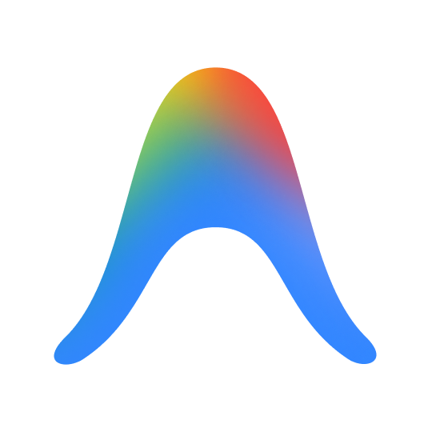

 

CURIOUS ABOUT THE PATTERNS. CAREFUL WITH THE CONCLUSIONS.

# Hey, I'm Nikhil.

**Analytics Engineer · Automation Builder**

I turn raw data into clear decisions—and build the pipelines that get it there.

 

## My toolkit

   &nbsp;
   &nbsp;
   &nbsp;
   &nbsp;
   &nbsp;
   &nbsp;
   &nbsp;
   &nbsp;
   &nbsp;
   &nbsp;
   &nbsp;
  

   &nbsp;
   &nbsp;
   &nbsp;
   &nbsp;
   &nbsp;
   &nbsp;
   &nbsp;
   &nbsp;
   &nbsp;
   &nbsp;
  
  

  <!--  &nbsp; -->
  
   &nbsp;
   &nbsp;
   &nbsp;
   &nbsp;
   &nbsp;
   &nbsp;
   &nbsp;
   &nbsp;
   &nbsp;
   &nbsp;
  
  

---

FIND THE PATTERN. BUILD SOMETHING USEFUL.

